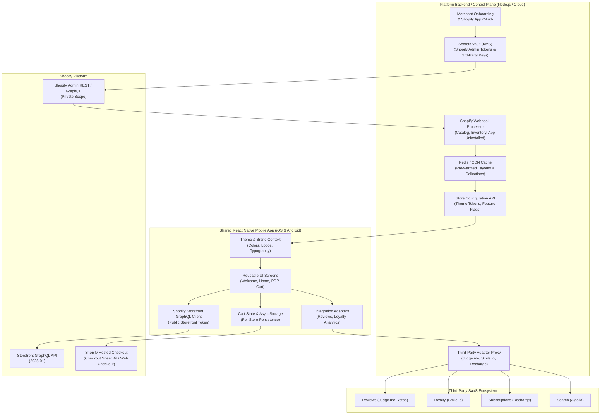

# Architecture & Third-Party Integration Plan

This document addresses **Task 1** of the Shopify Store to Mobile App assignment. It outlines the architectural design for transforming arbitrary Shopify stores into branded iOS and Android native apps using a **single shared React Native codebase**.

---

## 1. High-Level Architecture Diagram

---

## 2. Core Architectural Pillars

### A. Shared React Native Codebase with Store-Specific Branding
- **Single Source of Truth**: All mobile screens (`Welcome`, `Home`, `ProductDetails`, `Cart`) and domain logic (`shopifyService`, `cartService`, `reviewsService`) exist within one shared React Native codebase.
- **Dynamic Configuration Injection**: A centralized configuration file (`src/config/stores.ts` locally, or fetched remotely from the BFF) provides the store ID, name, logo, typography scale, palette (`primaryColor`, `surfaceColor`, `cardColor`), and `features` flags (`reviews`, `loyalty`).
- **Zero Screen Forking**: Screen components consume `useStore().storeConfig` via React Context. Brand styling and feature availability adapt instantly without modifying screen components.

### B. Merchant Onboarding & Secure Credential Handling
1. **OAuth Installation**: Merchants install our platform app via the Shopify App Store using OAuth 2.0 with minimal required scopes (`read_products`, `unauthenticated_read_product_listings`, `unauthenticated_write_checkouts`, `read_customers`).
2. **Strict Credential Isolation**:
   - The platform backend exchanges the authorization code for a **Shopify Admin API access token**.
   - **Crucial Rule:** Shopify Admin API tokens, partner client secrets, and database credentials are stored in a managed secrets manager (AWS Secrets Manager / GCP Secret Manager / Vault). **They are NEVER bundled into or exposed to the mobile app.**
   - The backend provisions a **public Storefront Access Token** for the merchant's store domain and delivers only public keys to the mobile app.

### C. Shopify APIs (Products, Variants, Cart, Accounts, Checkout)
- **Products & Collections**: Queried using the **Shopify Storefront GraphQL API** (`query GetProducts`, `query GetProductByHandle`). Variant IDs (`gid://shopify/ProductVariant/...`) serve as canonical identifiers across the app.
- **Cart Lifecycle**: Managed through Storefront GraphQL mutations (`cartCreate`, `cartLinesAdd`, `cartLinesUpdate`, `cartLinesRemove`) and mirrored in local `AsyncStorage` for instant offline and cold-start UX.
- **Customer Accounts**: Uses **Shopify Customer Account API** via OAuth 2.0 + PKCE in an in-app browser (`ASWebAuthenticationSession` on iOS, Chrome Custom Tabs on Android). Passwords are never handled directly by the app.
- **Checkout Execution**: The app passes `cartId` to get Shopify's hosted `checkoutUrl`. In production, checkout executes via `@shopify/checkout-sheet-kit` or in-app secure browser. Shopify natively processes shipping, taxes, promotions, payment gateways, and Shop Pay with complete PCI compliance.

### D. Backend, Caching, Synchronization & Reusable Adapters
- **Backend-For-Frontend (BFF)**: Normalizes responses, powers merchant config APIs, and securely signs requests to third-party services whose APIs require private merchant keys.
- **Caching & Webhooks**:
  - Shopify webhooks (`products/update`, `inventory_levels/update`, `app/uninstalled`) trigger cache invalidation in Redis/Cloudflare.
  - Product stock and price checks are re-verified on PDP open and before checkout submission to prevent stale inventory drift.
- **Reusable Integration Adapters**: Third-party features are wrapped behind standardized interfaces returning `{ status: 'success' | 'unavailable', data, fallbackMessage }`. Swapping vendors (e.g., Judge.me to Yotpo) requires changing only the backend adapter, leaving React Native screens untouched.

### E. Whitelabel Build, Release & Update Strategy
- **Build Pipeline**: Fastlane + GitHub Actions (or Expo Application Services / EAS Build) reads a merchant manifest JSON to inject native app metadata:
  - App Name, Bundle Identifier (`com.merchant.store`), Android Application ID
  - App Icons, Android Adaptive Icons, and iOS Launch Storyboard
  - Push Notification certificates (APNs & FCM)
  - Deep-link custom URL scheme (`storeapp://`)
- **Release Channels**:
  - **Native Builds**: Android App Bundles (AAB) and iOS IPAs are uploaded automatically to Google Play Console and App Store Connect tracks.
  - **Over-The-Air (OTA) Updates**: CodePush or EAS Update deploys JavaScript, styling, and asset patches instantly without requiring app store re-review.
  - **Remote Feature Flags**: Store config updates (banner copy, primary colors, feature toggles) take effect immediately via remote JSON endpoints.

---

## 3. Scope Classification: Configurable vs. New Build vs. Custom Development

| Category | Definition | Examples | Delivery Path |
|---|---|---|---|
| **Configurable** | Dynamic changes handled through remote JSON or feature toggles without modifying native binaries or code. | Brand colors, logo URLs, typography scales, hero banner text, feature flags (`reviews: true`, `loyalty: true`), home collection order, navigation links. | Remote Config API / BFF JSON response (instant). |
| **Requires New Build** | Changes that alter native binaries, device permissions, or app-store identity. | App store launcher icon, splash screen, iOS Bundle ID, Android Package Name, APNs/FCM push certs, deep link schemes, adding new native SDK modules. | Automated Fastlane CI/CD pipeline + Google Play / App Store binary release. |
| **Requires Custom Dev** | Complex bespoke merchant logic not covered by standard Shopify Storefront APIs or existing adapters. | Custom 3D/AR product viewers, bespoke multi-step sizing quiz engines, custom native checkout extensions, proprietary legacy ERP connectors. | Engineering sprint, new adapter interface, and dedicated unit/integration tests. |

---

## 4. Third-Party Compatibility Research (10 Categories)

### Architecture Classifications
1. **Shopify-Native Support**: Natively exposed through Shopify Storefront / Customer Account / Checkout APIs.
2. **Reusable Provider Integration**: Normalized BFF/SDK adapter shared across merchants using that provider.
3. **Web-Based Fallback**: Authenticated in-app browser (`WebView` / Custom Tabs) for web-only flows.
4. **Unsupported Feature**: Cleanly omitted or replaced with a fallback UI when native mobile support is impossible.

| # | Category & Representative Provider | Integration Classification | Recommended Approach | Fastest Implementation | Failure or Fallback Strategy |
|---|---|---|---|---|---|
| 1 | **Reviews** [Judge.me API Docs](https://judge.me/api/docs) | Reusable Provider Integration | BFF adapter fetches reviews by Shopify product ID and returns normalized `{ averageRating, totalCount, reviews }`. | Render rating badge and verified reviews list in a modular `ReviewsSection` component. | Show a `"Reviews temporarily unavailable"` notice. Sizing, pricing, and Add to Cart remain fully functional. |
| 2 | **Loyalty** [Smile.io API Docs](https://docs.smile.io/) | Reusable Provider Integration | BFF maps logged-in customer ID to Smile.io API to query points balance and redeemable discounts. | Display static points-per-dollar banner on PDP/Cart; launch hosted Smile member portal in authenticated WebView. | Hide the loyalty banner if API fails; link to merchant's web loyalty page. |
| 3 | **Subscriptions** [Recharge Developer Docs](https://developer.rechargepayments.com/) | Shopify-Native + Reusable Provider | Read Shopify `sellingPlanGroups` via Storefront GraphQL and pass `sellingPlanId` to `cartLinesAdd`. | Display One-Time vs. Subscribe & Save toggle on PDP; customer manages active subscriptions via Recharge portal in WebView. | Default to one-time purchase if subscription selling plan metadata cannot be loaded. |
| 4 | **Search** [Algolia Shopify Guide](https://www.algolia.com/doc/integration/shopify/getting-started/quick-start/) | Reusable Provider / Shopify-Native | Use Algolia InstantSearch index synced from Shopify for instant, typo-tolerant search and facet filtering. | Query Shopify Storefront API's native `predictiveSearch` or `products(query: $query)` GraphQL operation. | Fall back to Shopify Storefront GraphQL product search query if Algolia quota or network fails. |
| 5 | **Discounts & Bundles** [Shopify Functions Docs](https://shopify.dev/docs/apps/build/discounts) | Shopify-Native Support | Pass coupon codes via Storefront `cartDiscountCodesUpdate`; Shopify Functions evaluate automatic discounts & bundles in cart. | Let Shopify Checkout evaluate complex discount and bundle rules natively at checkout URL. | Display `"Discounts and bundle pricing applied at checkout"` note if local cart preview cannot evaluate custom script rules. |
| 6 | **Notifications** [OneSignal React Native SDK](https://documentation.onesignal.com/docs/react-native-sdk-setup) | Reusable Provider Integration | Initialize OneSignal SDK with per-merchant `appId` at build time; BFF triggers automated abandoned-cart & back-in-stock pushes. | Inject App ID into native manifest; route notification tap to product screen via deep link (`storeapp://product/:handle`). | App functions normally if user declines push permissions; fall back to in-app announcement banners. |
| 7 | **Analytics** [Amplitude React Native Docs](https://amplitude.com/docs/sdks/analytics/react-native/react-native-sdk) | Reusable Provider Integration | Thin `analyticsService.track(event, props)` dispatcher forwarding `view_product`, `add_to_cart`, `begin_checkout` tagged with `storeId`. | Single typed event tracking wrapper initialized with per-store API write key. | Queue events offline and discard gracefully if analytics endpoints are unreachable; never block UI interactions. |
| 8 | **Customer Support** [Gorgias Chat Docs](https://docs.gorgias.com/en-US/help-center-chat-on-mobile-apps-249217) | Web-Based Fallback / Provider SDK | Open Gorgias hosted chat / Help Center URL inside an in-app browser modal with customer session and order context pre-filled. | Embed merchant's Gorgias chat URL inside a clean React Native modal WebView or Custom Tab. | Fall back to static customer support email link (`mailto:`) and FAQ screen if chat service fails. |
| 9 | **Order Tracking** [AfterShip Quickstart](https://www.aftership.com/docs/tracking/quickstart) | Shopify-Native + Reusable Provider | Fetch fulfillment status and carrier tracking number from Shopify Customer Account API; enrich milestones via AfterShip API. | Deep-link user to Shopify Order Status web page or carrier tracking URL from the orders screen. | Show Shopify native fulfillment state (`Unfulfilled`, `In Transit`, `Delivered`) with tracking link fallback. |
| 10 | **Returns** [Loop Returns Docs](https://docs.loopreturns.com/) | Web-Based Fallback | Launch merchant's hosted Loop Returns portal (`https://merchant.loopreturns.com`) inside an authenticated in-app browser. | Add a `"Start a Return"` button in order history that opens the merchant's Loop portal URL. | Fall back to merchant contact/support page if no returns portal is configured (unsupported in native UI). |

---

## 5. Handling Unfamiliar Shopify Apps or Theme Customizations

1. **Investigate Data & Integration Surface**:
   - Determine whether the custom feature is implemented purely as **Liquid / CSS / DOM JavaScript** (e.g., custom announcement ticker, table-based size chart) or backed by a **Shopify App backend** (metafields, webhooks, app proxy).
2. **Examine Shopify-Native Equivalents**:
   - Check if the customization stores its data in Shopify **Metafields / Metaobjects** (`product.metafield(namespace: "...", key: "...")`) or **Shopify Functions**. If so, it is already queryable via the Storefront GraphQL API without building custom infrastructure.
3. **Classify Feasibility**:
   - **Native Storefront API / Metafield data** → Map directly into existing UI sections.
   - **Third-party REST/GraphQL API available** → Build a normalized integration adapter behind a feature flag if multiple merchants share the requirement.
   - **Custom Liquid / Web-only script** → Render inside an authenticated `WebView` modal fallback, or clearly explain to the merchant why native mobile apps do not execute browser DOM scripts.
4. **Never Promise 1:1 Theme Parity Blindly**: Clearly distinguish native mobile screens from responsive web pages during merchant scoping.

---

## 6. Three Major Technical Risks & Proposed Solutions

### Risk 1: Inventory, Variant & Price Desynchronization
- **Impact**: Customers see stale cached prices or add items to their cart that have gone out of stock, leading to checkout failures and customer frustration.
- **Solution**:
  - Storefront product variants (`gid://shopify/ProductVariant/...`) and `availableForSale` flags are the single source of truth.
  - Re-fetch real-time variant availability and price on PDP entry.
  - Catch `userErrors` returned by Shopify Storefront `cartLinesAdd` and `cartCreate` to immediately alert users of stock changes.

### Risk 2: Fragile Third-Party App Outages Breaking Shopping Flow
- **Impact**: A slow or malfunctioning third-party API (such as reviews or loyalty) hangs the screen or crashes the checkout flow.
- **Solution**:
  - Strict adapter isolation with short request timeouts (e.g., 2.5 seconds) and circuit breakers.
  - Adapters always return `{ status: 'success' | 'unavailable' }`.
  - Non-critical third-party UI degrades gracefully to helpful fallback messages without blocking the core browse, variant selection, or checkout journey.

### Risk 3: Release Overhead & Drift Across Dozens of Merchant Binaries
- **Impact**: Maintaining separate git repositories or manually building binaries for dozens of merchants leads to high maintenance overhead and slow bug fixes.
- **Solution**:
  - Maintain a **single shared React Native codebase** driven by merchant configuration manifests.
  - Automate whitelabel binary builds with Fastlane and parameterized CI/CD pipelines (Android flavors and iOS Xcode targets).
  - Use Over-The-Air (OTA) updates and remote configuration for UI enhancements and bug fixes that do not touch native SDKs.

---

## 7. Recommended Framework, Libraries & Tools

- **Mobile Framework**: React Native (TypeScript) — single cross-platform codebase, strong ecosystem, and direct support from Shopify.
- **Checkout Experience**: `@shopify/checkout-sheet-kit` — Shopify's official native checkout sheet supporting Shop Pay, Apple Pay, and Google Pay.
- **Local Persistence**: `@react-native-async-storage/async-storage` — reliable, cross-platform persistence for multi-store carts and active store states.
- **API Communication**: Native `fetch` with TypeScript typing against Shopify Storefront GraphQL API (2025-01).
- **Navigation**: Lightweight pure-React navigation stack (or `@react-navigation/native-stack`) for predictable, zero-dependency routing.
- **Whitelabel CI/CD**: Fastlane + GitHub Actions / EAS Build for automated Android AAB and iOS IPA generation.
- **Error & Performance Monitoring**: Sentry React Native SDK tagged by `storeId` and `storefrontApiVersion`.

